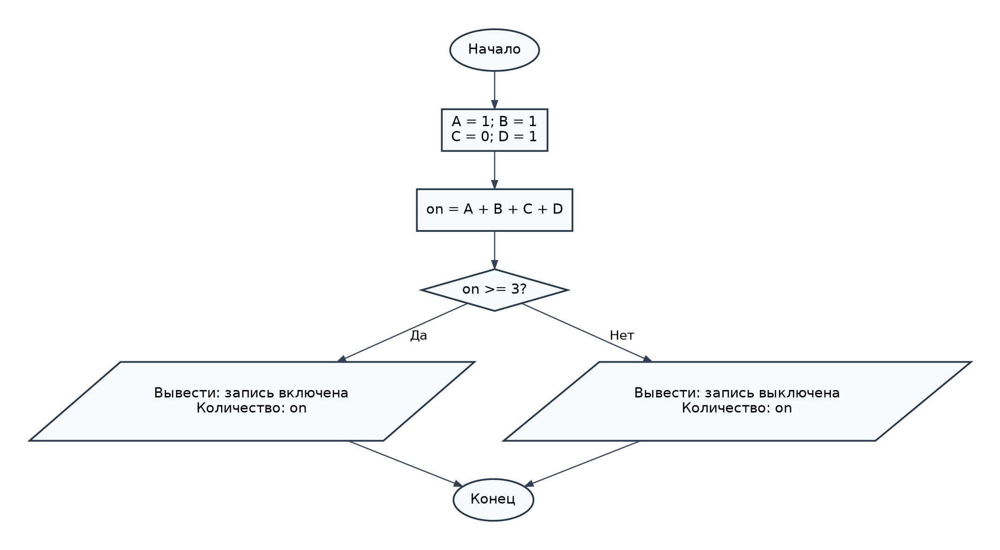

# Лабораторная работа № 4 — Вариант 8

## Условие задачи

**Сигнализация в музее.** В зале музея четыре датчика движения (A, B, C, D). Чтобы избежать ложных срабатываний, сигнализация включает запись только если не менее трёх датчиков сработали. Запишите условие включения записи.

## 1. Алгоритм и блок-схема

### Алгоритм

1. Начало программы.
2. Задать значения датчиков: `A = 1`, `B = 1`, `C = 0`, `D = 1`.
3. Вычислить количество сработавших датчиков: `on = A + B + C + D`.
4. Проверить условие `on >= 3`:
   - если условие истинно, вывести «Запись включена» и число сработавших датчиков;
   - иначе вывести «Запись выключена» и число сработавших датчиков.
5. Конец программы.

### Блок-схема



[Открыть блок-схему](images/block_scheme.png)


## 2. Реализация программы

Программа написана на языке **C** для **Microsoft Visual Studio** (Windows). Значения датчиков заданы в коде.

```c
#include <stdio.h>
#include <locale.h>
#include <windows.h>

int main(void)
{
    SetConsoleOutputCP(65001);

    int A = 1;
    int B = 1;
    int C = 0;
    int D = 1;

    int on = A + B + C + D;

    if (on >= 3) {
        printf("Запись включена. Сработало датчиков: %d\n", on);
    }
    else {
        printf("Запись выключена. Сработало датчиков: %d\n", on);
    }

    return 0;
}
```

Для запуска откройте `main.c` в проекте Visual Studio и нажмите **Ctrl + F5**. Сохраните файл в кодировке UTF-8, чтобы русские сообщения отображались корректно.

## 3. Результат работы программы

### Контрольный пример 1 — запись включена

Значения датчиков: `A = 1`, `B = 1`, `C = 0`, `D = 1`.

```text
Запись включена. Сработало датчиков: 3
```

### Контрольный пример 2 — запись выключена

Если в исходном коде установить `A = 1`, `B = 0`, `C = 0`, `D = 1`, программа выведет:

```text
Запись выключена. Сработало датчиков: 2
```

### Контрольный пример 3 — сработали все датчики

Если установить `A = 1`, `B = 1`, `C = 1`, `D = 1`, программа выведет:

```text
Запись включена. Сработало датчиков: 4
```

**Вывод:** запись включается при срабатывании трёх или четырёх датчиков, что соответствует условию задачи.

## 4. Информация о разработчике

**Жаворонков Богдан, бТИИ-262**
